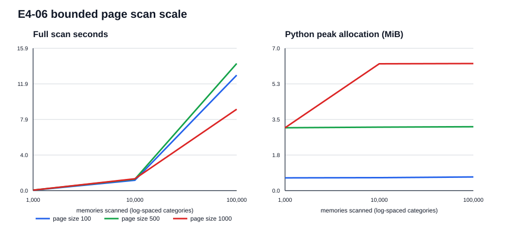

# E4-06 — bounded keyset page scan benchmark

Measured at source commit `69bf463de2f4e7a6c637e59c555e320a5e1bcb1d` on Windows AMD64, 8 CPUs, Python 3.13.5. The fixture contains one complete `MemoryCreated` event per synthetic memory. Scans use `EventLog.read(since_seq=cursor, limit=page_size)` and repeat three times for each size/page combination.

| memories | page size | pages | full scan mean (s) | mean page latency (ms) | Python peak (MiB) | DB bytes | stable digest |
|---:|---:|---:|---:|---:|---:|---:|---|
| 1,000 | 100 | 10 | 0.047 | 4.21 | 0.63 | 933,888 | True |
| 1,000 | 500 | 2 | 0.054 | 23.15 | 3.10 | 933,888 | True |
| 1,000 | 1,000 | 1 | 0.054 | 42.76 | 3.10 | 933,888 | True |
| 10,000 | 100 | 100 | 1.159 | 10.42 | 0.64 | 9,109,504 | True |
| 10,000 | 500 | 20 | 1.284 | 57.77 | 3.13 | 9,109,504 | True |
| 10,000 | 1,000 | 10 | 1.320 | 118.40 | 6.26 | 9,109,504 | True |
| 100,000 | 100 | 1000 | 12.875 | 11.60 | 0.68 | 91,136,000 | True |
| 100,000 | 500 | 200 | 14.172 | 64.67 | 3.15 | 91,136,000 | True |
| 100,000 | 1,000 | 100 | 9.079 | 82.89 | 6.27 | 91,136,000 | True |

Every dataset's chain verified before scans; every scan returned exactly the expected ordered IDs with matching hashes across repeats. Per-page result size never exceeded the configured bound. WAL mode and checkpoint result are recorded per dataset in the JSON artifact. Database setup and scan time are separate.

The benchmark demonstrates O(N) full-scan work and bounded per-page Python allocation for the event-log cursor. It does not establish bounds for `memory-fabric list`: that operator path currently materializes all projected memories and sorts them before applying its output limit. That failing regime is recorded for follow-up rather than conflated with event-log pagination.

Synthetic fixtures, warm SQLite cache, and one local host limit generalization. Raw measurements and all configuration are in [e4-06-page-scan.json](e4-06-page-scan.json).
